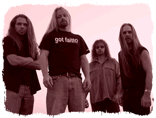

{: .align-left} We play original Christian music usually classified as hard rock or Christian rock. Together since 1995, we are a three-piece band with a lead vocalist. We are currently in production on our third independent studio project. Our first CD is entitled The Time of my Return, recorded in 1997. We recorded this CD as a four-piece band with Jay Woody as lead vocalist. Our bass player left before the CD was released so we released it as a trio with Jay playing bass and doing most of the lead vocals. This project was recorded in a studio and while the production is less than perfect, overall this was a good start for a band only two years old. Our current set list includes several songs from The Time of my Return, and they are still just as powerful today as they were back then.

After several years of traveling as a three-piece it was time to put out a new CD. In 2002, we began to record our next project entitled Once and for All. Bobby decided to attempt to make a studio and record it himself which after much trial and error proved to be the right way to go. Halfway through the project it was discovered that Bobby had made some vital mistakes and had to begin the process all over. With some help and guidance on printing and graphics from David Kelsey of Soul Joy Records, Once and for All was shaping up to be a strong project musically and needed strong vocals to match and there were none stronger than Steve Pettit. Steve joined the band and then there were four again. In late 2003 early 2004, the CD was finished and bore the Soul Joy Records logo. Jesus Joshua had become an even stronger force for the kingdom of God.

In early 2006 production began on 3 The Hard Way, the third CD from Jesus Joshua 24:15. This CD has a heavier feel and tons of fire. 3 The Hard Way stands as the bands best work to date and a must-have for Jesus Joshua 24:15 fans as well as a must-hear for the world.
